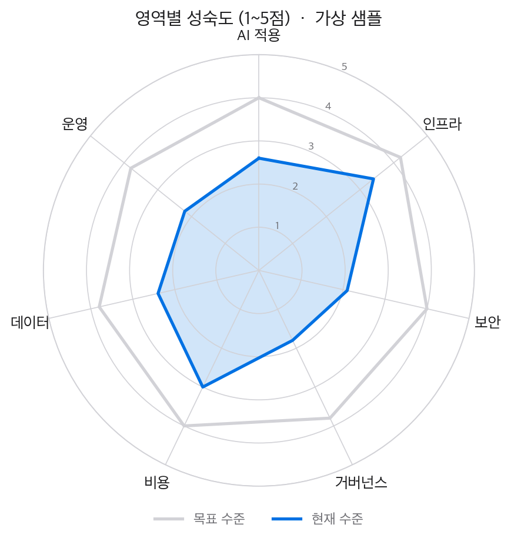
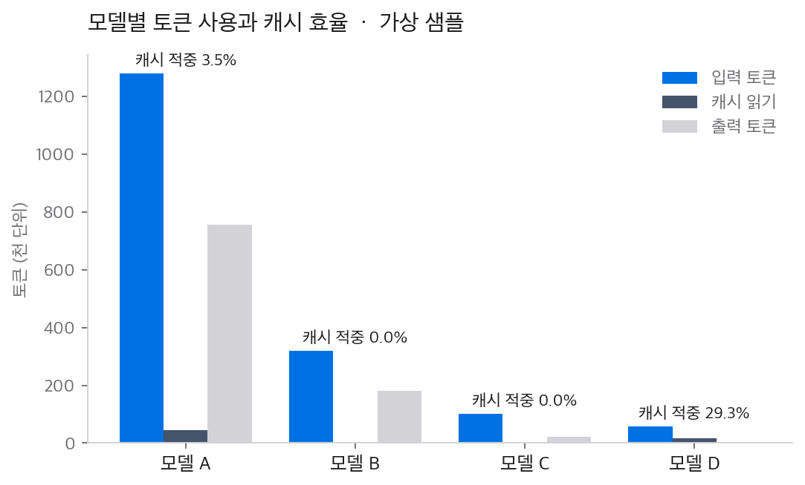
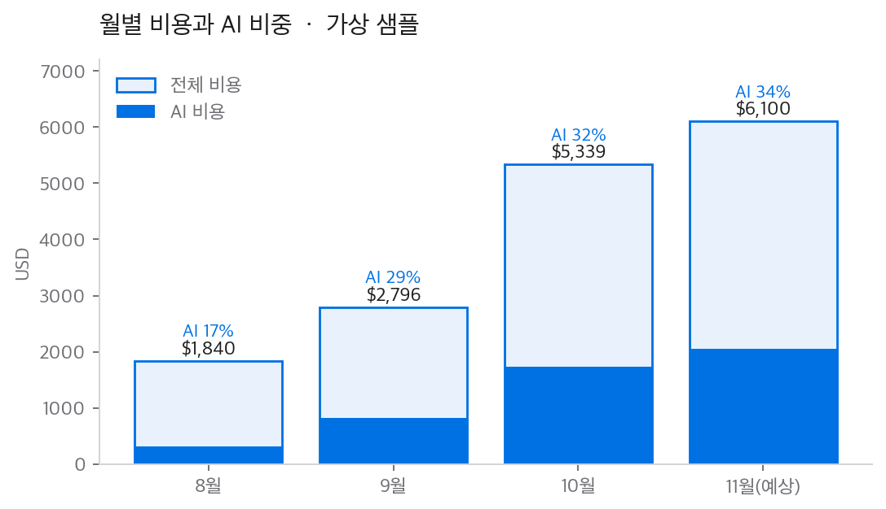
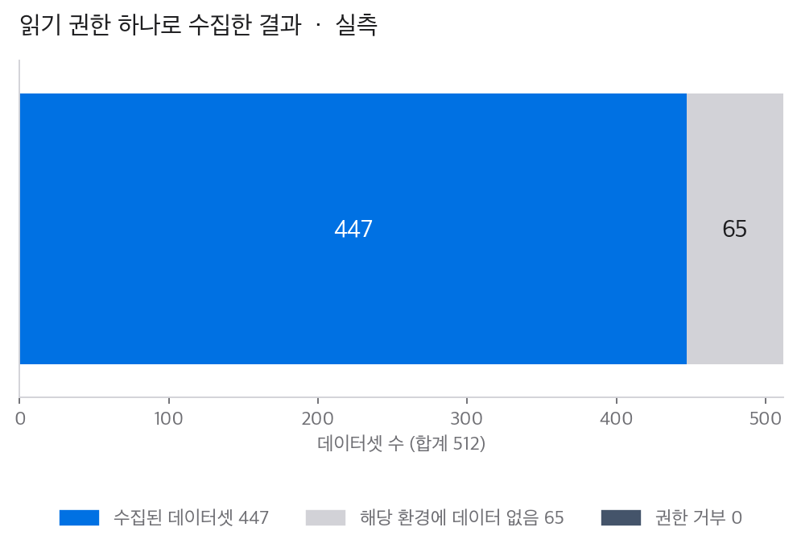

# AI Assessment 시스템

고객의 Azure 환경과 AI 사용 현황을 **공식 기준에 근거해 진단**하고, 진단 결과를 **보고서와 아키텍처 도면**으로 만드는 시스템입니다. AI 도입 전 조직에는 도입 방향을, 이미 AI를 쓰는 조직에는 운영 개선 과제를 제시합니다.

> 이 문서의 그래프 중 `가상 샘플`로 표기한 것은 형태를 보여 주기 위한 예시이며 실제 고객 값이 아닙니다. `실측`으로 표기한 것만 시험 환경에서 측정한 값입니다.

---

## 1. 해결하는 문제

| 기존 방식 | 문제 | 이 시스템의 방식 |
|---|---|---|
| 담당자가 포털을 둘러보고 점검표 작성 | 담당자마다 범위·판정이 다르고 근거가 남지 않음 | 수집기가 같은 항목을 같은 방식으로 수집하고 항목마다 근거 ID를 부여 |
| 인터뷰 내용과 환경 점검이 따로 정리됨 | 두 결과가 하나의 진단으로 이어지지 않음 | 인터뷰 답변과 수집 사실을 한 현황으로 통합해 분석 |
| 보고서 수치를 사람이 옮겨 적음 | 오기, 영역 간 수치 불일치 | 수치·집계는 코드가 확정하고 문장은 근거 ID를 참조 |
| 비용 절감 제안이 일반론에 머무름 | 어떤 모델·호출이 비용을 만드는지 불명확 | 호출 단위 토큰·캐시·지연·비용 데이터를 대조해 원인 제시 |

---

## 2. 처리 흐름

```
 ┌────────────┐   ┌────────────┐   ┌────────────┐   ┌────────────┐   ┌────────────┐
 │ ① 인터뷰   │   │ ② 현황수집 │   │ ③ 영역별   │   │ ④ 비용·토큰│   │ ⑤ 종합     │
 │  질문별    │ → │  읽기 권한 │ → │  현황분석  │ → │  분석      │ → │  보고서    │
 │  녹음·요약 │   │  수집기    │   │  (7개 영역)│   │  (최적화)  │   │  Word/PPT  │
 └────────────┘   └────────────┘   └────────────┘   └────────────┘   └────────────┘
       │                │                │                │                │
       └────────────────┴──── 공식 기준 130개 항목(근거 ID) ───────────────┘
```

1. **인터뷰**: 질문마다 녹음하고, 질문 취지에 맞게 요약·점수화합니다. 수집으로 알 수 없는 내용(조직·운영·계획)을 채웁니다.
2. **현황 수집**: 고객이 부여한 읽기 권한으로 구독 안의 구성·정책·보안 평가·비용·AI 호출 지표를 가져옵니다.
3. **영역별 현황분석**: 사실을 묶어 영역별 시사점과 개선 과제를 도출합니다.
4. **비용·토큰 분석**: 모델별 토큰, 캐시 적중, 지연, 월별 비용을 대조합니다.
5. **종합 보고서**: Word 보고서, PPT, 아키텍처 도면, Excel 근거 데이터를 만듭니다.

---

## 3. 진단 기준: 공식 문서에서 가져온 130개 항목

진단 기준은 임의로 만든 점검표가 아니라 **Microsoft 공식 문서의 원문 문장**입니다. 각 항목에 원문 인용, 출처 URL, 수집 시점의 문서 해시(SHA-256)가 붙습니다.

| 기준 묶음 | 항목 수 | 출처 |
|---|---|---|
| Well-Architected Framework: AI 워크로드 | 48 | learn.microsoft.com |
| AI Landing Zone 설계 체크리스트 | 44 | azure.github.io |
| Cloud Adoption Framework: AI | 22 | learn.microsoft.com |
| Microsoft Cloud Security Benchmark: Azure OpenAI | 16 | learn.microsoft.com |

- 130개 모두 원문과 해시를 보유합니다(130/130).
- 항목은 원문의 서술 강도에 따라 **"should"(권고) 109건, "consider"(검토) 21건**으로 분류되어 있습니다.
- 출처가 바뀌면 해시가 달라져 기준 갱신 여부를 기계적으로 검출합니다.

---

## 4. 산출물 샘플

### 4.1 영역별 성숙도 (스파이더)

7개 영역을 1~5점으로 평가하고 목표 수준과 비교합니다.



### 4.2 모델별 토큰 사용과 캐시 효율

호출 로그에서 모델별 입력·캐시 읽기·출력 토큰을 집계합니다. 입력이 큰데 캐시 적중이 낮은 모델은 프롬프트 앞부분 고정, 캐시 키 지정 같은 개선 대상으로 분류합니다.



> 형태는 시험 환경의 실제 로그 구조와 같고, 수치는 가상입니다.

### 4.3 월별 비용과 AI 비중



### 4.4 읽기 권한 하나로 수집한 범위 (실측)

시험 환경에서 구독 읽기 권한(Reader)만으로 수집기를 끝까지 실행한 결과입니다. 권한 거부로 실패한 항목은 0건이었습니다.



| 항목 | 값 |
|---|---|
| 수집된 데이터셋 | 447 |
| 해당 환경에 데이터 없음 | 65 |
| 권한 거부 | 0 |

`데이터 없음`은 해당 리소스가 환경에 존재하지 않는다는 의미이며, 수집 실패·권한 부족과 다른 상태로 기록합니다.

---

## 5. 수집하는 AI 데이터

호출 단위 로그에서 **프롬프트·응답 본문은 가져오지 않고**, 길이·건수·해시 개수 같은 집계값만 가져옵니다.

| 구분 | 수집 항목 | 최적화 용도 |
|---|---|---|
| 요청 사용량 | 모델·배포별 입력·캐시 읽기·캐시 쓰기·출력 토큰, 긴 컨텍스트 구간 토큰 | 모델 선택, 캐시 전략 |
| 지연 | 첫 토큰 시간, 마지막 토큰 시간 | 사용자 체감 성능 |
| 호출자 | 호출자 수, 상위 호출자 점유율(식별자는 해시) | 사용량 쏠림, 키 공유 위험 |
| 오류·제한 | 응답 코드, 속도 제한(429) 비율 | 용량·재시도 설계 |
| 비용 | 월·일·리소스별 비용, 모델 추정 비용 | 비용 대조 |
| 에이전트 추적 | 에이전트·대화·도구 호출 단위 토큰, 도구 정의 크기 | 컨텍스트 비대화 진단 |
| 게이트웨이 | API Management 구독별 토큰·지연·오류 | 소비자별 사용량 |

---

## 6. 장점

**근거가 남습니다.** 보고서의 판단 문장은 근거 ID(`fact_refs`)를 참조하도록 설계되어 있고, 영역별 분석 원장에 항목·시사점이 근거 ID와 함께 기록됩니다.

**재현됩니다.** 같은 환경을 같은 기준으로 수집하면 같은 사실이 나옵니다. 담당자가 바뀌어도 범위가 달라지지 않습니다.

**최소 권한으로 수집합니다.** 수집기는 조회 호출(GET과 조회 전용 POST 일부)만 허용하고 접속 호스트를 Azure 관리 API와 Log Analytics로 제한합니다. 스토리지 키·Key Vault 비밀은 요청하지 않습니다. 수집기 스크립트는 이 공개본에 포함되어 있지 않습니다.

**수치가 어긋나지 않도록 분업합니다.** 집계·점수·영역 합계는 코드가 계산하고, 모델은 해석 문장을 작성합니다.

**없는 것과 못 가져온 것을 구분합니다.** `데이터 없음`, `권한 부족`, `로깅 꺼짐`, `수집 실패`를 다른 상태로 기록해 보고서가 "없다"고 잘못 단정하지 않습니다.

**중단돼도 이어집니다.** 작업은 단계별로 저장되며 중단된 지점부터 재개합니다.

---

## 7. 활용 시나리오

| 상황 | 활용 |
|---|---|
| AI 도입 전 고객 | 현재 인프라·보안·거버넌스 수준을 진단하고 AI Landing Zone 기준의 갭과 도입 순서를 제시 |
| 이미 AI를 쓰는 고객 | 모델별 토큰·캐시·지연 데이터로 비용과 성능 개선 과제를 도출 |
| 비용이 급증한 고객 | 월별 비용 증가를 서비스·리소스·모델별로 분해하고 원인 후보를 제시 |
| 보안 점검 | 네트워크 노출, 인증 방식, 키 사용, 모니터링 설정을 공식 보안 벤치마크 항목에 대응 |
| 임원 보고 | 영역별 성숙도와 개선 로드맵을 장표 한 벌로 제공 |

---

## 8. 저장소 구성

```
app/        포털 서버, 분석·보고서 생성 모듈, 공식 기준 원문(criteria.json), 양식 템플릿
app/tests/  결정적 시험(약 225개 파일)
tools/      소스 보안 검사
docs/       이 문서와 그림
```

- 공개본은 환경 식별 정보(구독·리소스·도메인)를 자리표시자 `<...>`로 바꿨고 커밋 이력을 포함하지 않습니다.
- 실행하려면 환경 변수로 실제 값을 주입해야 합니다.
- 고객 데이터, 답변, 녹음, 계정 정보, 생성 산출물은 저장소에 포함하지 않습니다.

## 9. 현재 한계

- 그래프 4.1~4.3은 **가상 샘플**입니다. 4.4만 시험 환경의 실측입니다.
- 실측은 구독 1개, 사용자가 사실상 1명인 내부 환경 기준입니다. 고객 환경에서 같은 데이터 품질이 나온다는 보장은 아닙니다.
- Foundry 프로젝트의 에이전트·파일·평가 같은 **데이터 평면 항목**은 읽기 권한만으로는 수집되지 않으며, 별도 역할 부여가 필요합니다.
- API Management 로그 수집은 문서 스키마 기준으로 설계했고, 시험 환경에는 API Management가 없어 **실데이터 검증은 하지 못했습니다.**
- 로그 필드 일부(`AzureOpenAIRequestUsage` 등)는 Microsoft가 스키마를 공식 문서화하지 않은 관찰값이므로 변경 감시가 필요합니다.
